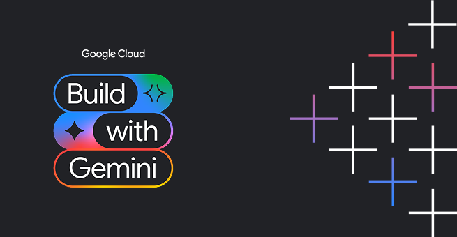
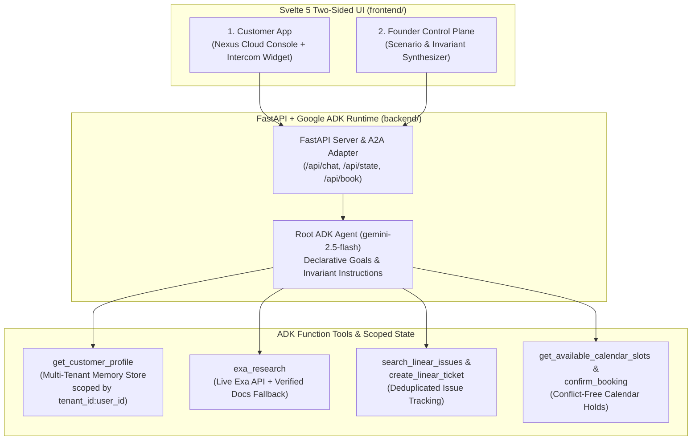

<div align="center">



# ✦ Nexus Ops — Declarative Goal-Driven Support Agent

### Tell what needs to be true. The agent orchestrates the rest.

Built for **Build with Gemini · Track 3 (Agent-First Apps)** using **Google ADK**, **Gemini 2.5 Flash on Vertex AI**, **Multi-Tenant Memory Isolation**, and a **2-Sided Svelte 5 Operational UI**.

<br/>


</div>

---

## 💡 Overview

Traditional customer support bots follow rigid, brittle decision trees (*"If user says X, ask Y, then paste a link to a form"*). For lean engineering teams, that creates high customer friction and still leaves humans doing the administrative heavy lifting.

**Nexus Ops** replaces procedural scripts with **declarative goals** and **hard invariants**:
- **Desired Goal States**: What must become true for the customer's issue to be resolved (`customer_context_recognized`, `answer_grounded`, `customer_sentiment_checked`, `escalation_ready`).
- **Hard Invariants**: Rules the agent may never break — strict multi-tenant memory isolation, zero unverified technical claims, zero duplicate Linear bug tickets, and conflict-free calendar scheduling.

---

## 🖥️ Two-Sided Operational Experience

The application features two distinct operational surfaces in [`frontend/src/App.svelte`](frontend/src/App.svelte):

### 1. Surface 1: Customer Product Portal ("Nexus Cloud Platform" + Intercom Drawer)
Simulates a live B2B cloud console where customers monitor their API & webhook ingestion streams and open an embedded **Intercom-style autonomous support drawer**:
- **Multi-Tenant Organization Switcher**: Instantly switch between three pre-seeded enterprise tenants to test strict tenant scoping (`tenant_id:user_id`):
  - **Kenneth Pernyer** — CTO @ *Acme Logistics Corp* (`org_acme:kenneth`, Enterprise ERP)
  - **Erik Lindqvist** — CSO @ *FinPulse Banking* (`org_fintech:erik`, EU Sovereign Compliance in `europe-north1`)
  - **Maya Patel** — Head of Engineering @ *ShopEase Global* (`org_retail:maya`, 10x Black Friday Peak Load)
- **Live Pipeline Incident Triggers**: Trigger realistic 500 Server Error webhook payload incidents (`evt_9921_erp`, 5.2 MB payload) directly from the event stream table.
- **Inline Interactive Escalation Cards**: When an issue requires engineering escalation, the agent searches and files a tracked **Linear** ticket, queries open **Google Calendar** slots, and renders an interactive 1-click booking card inside the chat drawer that generates a confirmed Google Meet link.

### 2. Surface 2: Founder Control Plane ("Tell What Needs to Be True")
A Macaly-inspired policy studio where founders and support leads describe support scenarios in plain English and compile them into ADK goals and invariants without writing decision trees.

---

## 🏗️ System Architecture



---

## 🔧 Agent Tools & Enforced Invariants

Defined in [`backend/app/agent.py`](backend/app/agent.py), [`backend/app/support_tools.py`](backend/app/support_tools.py), and [`backend/app/memory_store.py`](backend/app/memory_store.py):

| Tool | Purpose | Enforced Invariant |
| :--- | :--- | :--- |
| `get_customer_profile(tenant_id, user_id)` | Loads organization metadata, role, and long-term customer facts from the multi-tenant memory store. | **Invariant 1 (Strict Tenant Isolation)**: Keyed strictly by `f"{tenant_id}:{user_id}"`; never leaks data across organizations. |
| `exa_research(topic_or_error)` | Queries the live Exa API (when `EXA_API_KEY` is set) or verified technical documentation for webhook, CORS, and auth specs. | **Invariant 2 (Grounded Answers)**: Never guess technical specs or SLAs; verify documentation before replying. |
| `search_linear_issues(query)` | Searches tracked engineering issues in the Linear store (`LINEAR_ISSUES_DB`). | **Invariant 3 (No Duplicate Tickets)**: Always search existing issues before creating a new ticket. |
| `create_linear_ticket(...)` | Opens a prioritized engineering bug (`ENG-xxx`) with reproduction context. | Skips creation and returns existing ticket ID if a matching title already exists. |
| `get_available_calendar_slots(days_ahead)` | Returns open 15-minute technical deep-dive slots filtered against existing bookings (`BOOKINGS_DB`). | **Invariant 4 (Availability Integrity)**: Only offer verified conflict-free slots. |
| `confirm_booking(...)` | Places a calendar hold for a selected `slot_id` and generates a Google Meet link. | Rejects double-booking if a `slot_id` has already been reserved. |

---

## 📂 Project Structure

```text
.
├── project_brief.md                 # Project summary & invariant overview
├── backend/                         # Google ADK & FastAPI backend (scaffolded via agents-cli)
│   ├── agents-cli-manifest.yaml     # ADK / Agent Runtime manifest (A2A enabled)
│   ├── pyproject.toml               # Python dependencies (google-adk, a2a-sdk, fastapi)
│   └── app/
│       ├── agent.py                 # Root ADK Agent (gemini-2.5-flash), goals & invariants
│       ├── support_tools.py         # Function tools (Exa, Linear, Calendar, Profile)
│       ├── memory_store.py          # Multi-tenant organization & memory partition store
│       ├── fast_api_app.py          # FastAPI REST endpoints (/api/chat, /api/state, /api/book) + A2A
│       └── app_utils/               # A2A route adapters, Reasoning Engine adapter, telemetry
└── frontend/                        # Svelte 5 + TypeScript + Vite web interface
    ├── package.json
    └── src/
        ├── App.svelte               # Customer Portal + Intercom Drawer + Founder Control Plane
        └── app.css                  # Styling
```

---

## 🚀 Getting Started Locally

### Prerequisites
- **Python 3.11–3.13** and [`uv`](https://docs.astral.sh/uv/)
- **Node.js 18+** and `npm`
- A **Google Cloud project** with the Vertex AI API (`aiplatform.googleapis.com`) enabled and Application Default Credentials configured:
  ```bash
  gcloud auth login
  gcloud auth application-default login
  ```

### 1. Start the ADK Backend (Port `8000`)

```bash
cd backend

# Copy and configure your environment variables
cp .env.example .env
# Edit .env to set GOOGLE_CLOUD_PROJECT=<your-gcp-project-id>
# Optional: set EXA_API_KEY=<your-exa-api-key> for live Exa web search

# Install dependencies and start the FastAPI + ADK server
uv sync
uv run uvicorn app.fast_api_app:app --reload --port 8000
```

### 2. Start the Svelte 5 Frontend

In a second terminal:

```bash
cd frontend
npm install
npm run dev
```

Open the local URL printed by Vite in your browser.

---

## 🧪 Demo Walkthrough

1. **Test Grounded Troubleshooting & Tenant Context**:
   - In **1. Customer App (Nexus Cloud + Intercom)**, verify you are logged in as **Kenneth Pernyer (Acme Logistics Corp)**.
   - Click **"Ask Support (Intercom) ↗"** on the active pipeline alert banner.
   - Watch the agent load Kenneth's `org_acme:kenneth` profile & memory context and run `exa_research` to suggest the `compression: gzip` and chunked-streaming workaround.
2. **Trigger Autonomous Escalation (Linear + Calendar Hold)**:
   - Click **"Report to Support"** on the failing `evt_9921_erp` (`500 Server Error`) row in the table (or tell the agent the workaround didn't resolve the issue and ask for a call).
   - The agent runs `search_linear_issues` $\to$ `create_linear_ticket` $\to$ `get_available_calendar_slots`, replies with the tracked Linear issue ID, and renders an interactive **Technical Escalation Hold** card in the chat drawer.
   - Select a time slot and click **"Confirm Google Meet"** to book the slot and generate a Meet link.
3. **Verify Multi-Tenant Isolation**:
   - Switch the active user chip in the top bar to **Erik Lindqvist (FinPulse Banking)** or **Maya Patel (ShopEase Global)** and ask about their environment—each tenant receives strictly isolated context.
4. **Explore the Founder Control Plane**:
   - Switch the top navigation toggle to **2. Founder Control Plane (Tell What Needs to Be True)** to synthesize new plain-English support policies into invariant cards.

---

## 🗺️ Current Status & Roadmap

- **Implemented & Working**:
  - Google ADK `root_agent` (`gemini-2.5-flash` on Vertex AI) with declarative goal/invariant system instructions.
  - Multi-tenant memory store partitioned by `tenant_id:user_id` (`memory_store.py`).
  - Function tools for customer profile lookup, Exa research (live API when `EXA_API_KEY` is provided + local documentation fallback), Linear issue search & deduplicated ticket creation (in-memory store), and conflict-free calendar slot lookup & booking (in-memory store).
  - Full 2-sided Svelte 5 UI with tenant switching, live tool-call badges, interactive slot booking cards, and the Control Plane scenario synthesizer UI.
- **Planned / Next Steps**:
  - Connect `memory_store.py` to a managed **Vertex AI Memory Bank** instance for cloud-persisted cross-session memory extraction.
  - Connect the Control Plane scenario synthesizer directly to a backend endpoint to dynamically hot-reload agent invariants at runtime.
  - Wire Linear and Google Calendar tools to live OAuth / production APIs alongside Firestore persistence.
